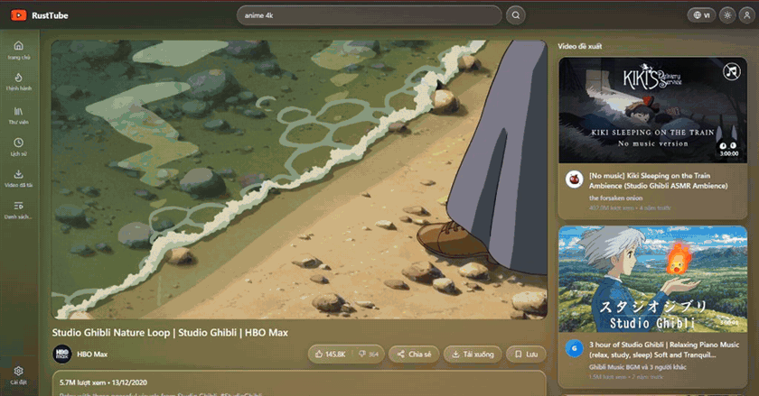
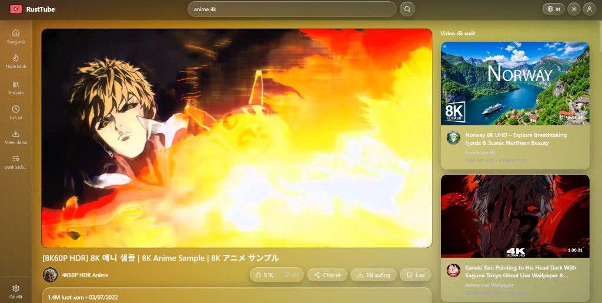
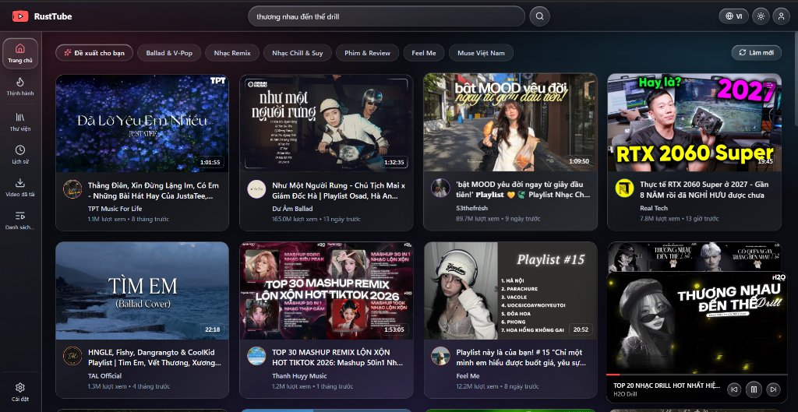

<div align="center">

# ▶ RustTube

**Ứng dụng xem YouTube & nghe nhạc nền siêu mượt dành riêng cho Windows 11 (64-bit)**  
*Ultra-Smooth YouTube Desktop Client with Liquid Glass UI — Exclusively for Windows 11 (64-bit)*

[](https://github.com/nhattamlb/rusttube/releases/latest)
[-0ea5e9?style=for-the-badge&logo=windows11&logoColor=white)](https://github.com/nhattamlb/rusttube/releases/latest)
[](https://github.com/nhattamlb/rusttube)
[](./LICENSE)

**[🇻🇳 Tiếng Việt](#-tiếng-việt) • [🇬🇧 English](#-english) • [📥 Tải xuống / Download](https://github.com/nhattamlb/rusttube/releases/latest/download/RustTube_1.3.6_x64-setup.exe) • [📋 Changelog](./CHANGELOG.md) • [⚖️ Điều khoản / Terms](./TERMS.md)**

</div>

---

## 🖼️ Giao diện & Chuyển động thực tế / Live Preview & Screenshots

<div align="center">
  
</div>

| **Real-Time Ambient Light & 4K/8K HDR Player** | **Liquid Glass Home, Adaptive Chips & MiniPlayer** |
| :---: | :---: |
|  |  |

---

## 🇻🇳 Tiếng Việt

### 📥 Tải xuống trực tiếp (Phiên bản mới nhất `v1.3.6`)

> [!IMPORTANT]
> **Yêu cầu hệ điều hành:** RustTube được thiết kế và tối ưu giải mã phần cứng **chỉ dành riêng cho Windows 11 (64-bit)**. Các hệ điều hành thấp hơn (Windows 10/8.1/7, Windows 32-bit) không được hỗ trợ.

- ⬇️ **[Tải bộ cài đặt trực tiếp: `RustTube_1.3.6_x64-setup.exe` (28 MB)](https://github.com/nhattamlb/rusttube/releases/latest/download/RustTube_1.3.6_x64-setup.exe)**
- 📦 **[Xem toàn bộ trang Phát hành (GitHub Releases)](https://github.com/nhattamlb/rusttube/releases/latest)** *(Bao gồm tệp chữ ký số `.sig`, `latest.json` và bảng mã băm `SHA256SUMS`)*

---

### 🛡️ Lưu ý cài đặt trên Windows 11 (Windows SmartScreen & Kiểm tra an toàn)

Vì **RustTube** là phần mềm độc lập phát hành miễn phí cho cộng đồng (chưa sử dụng chứng chỉ ký số thương mại EV Code Signing đắt đỏ của Microsoft), trong lần mở bộ cài đầu tiên, **Windows Defender SmartScreen** có thể hiển thị hộp thoại màu xanh *"Windows protected your PC"*:

1. Nhấn vào dòng chữ **More info** *(Thông tin thêm)*.
2. Nhấn nút **Run anyway** *(Vẫn chạy)* để tiến hành cài đặt bình thường (chỉ mất ~2 giây, không cần quyền Admin hệ thống).
3. Từ các bản nâng cấp về sau, ứng dụng tự động xác thực chữ ký mật mã **Ed25519** nội bộ và cập nhật mượt mà.

**Xác minh tính toàn vẹn tệp tin (`SHA-256 Checksum`):**
```text
Tệp tin : RustTube_1.3.6_x64-setup.exe
SHA-256 : ebbf9ded6018e9097d35b6e23c50b494f19b995e793c7b0953b3556b5f5e7732
```
Bạn có thể tự kiểm tra bằng **PowerShell** hoặc đối chiếu trực tiếp mã băm trên **[VirusTotal (Tra cứu SHA-256)](https://www.virustotal.com/gui/file/ebbf9ded6018e9097d35b6e23c50b494f19b995e793c7b0953b3556b5f5e7732)**:
```powershell
Get-FileHash .\RustTube_1.3.6_x64-setup.exe -Algorithm SHA256
```
> *Lưu ý về trình diệt virus (False Positive):* Bộ cài tích hợp sẵn công cụ dòng lệnh mã nguồn mở `yt-dlp` và tự tải `FFmpeg` để phục vụ chế độ Offline MP4/MP3, nên một số phần mềm diệt virus bên thứ ba quá nhạy có thể cảnh báo nhầm (False Positive). Bạn luôn có thể đối chiếu mã `SHA-256` ở trên với tệp `SHA256SUMS` đính kèm tại mục [Releases](https://github.com/nhattamlb/rusttube/releases/latest) để đảm bảo tệp nguyên bản 100%.

---

### ✨ Tính năng nổi bật

- **Hiệu năng gốc Rust + Tauri 2 siêu nhẹ:** Giải mã phần cứng **D3D11VA** trên Windows 11 mượt mà tới **4K/8K 60FPS**, tiêu thụ RAM & CPU thấp hơn nhiều lần so với mở tab trình duyệt.
- **Giao diện Liquid Glass & Ambient Light:** Hiệu ứng kính mờ phản quang tinh tế (có thanh trượt chỉnh độ trong suốt, đồng bộ Sáng / Tối theo Windows 11) kèm **Ambient Light** chiếu ánh sáng thời gian thực từ khung hình video tràn xuyên dưới thanh tiêu đề và thanh bên.
- **Đề xuất thông minh không cần đăng nhập:** Tự động nhận diện xu hướng vùng mạng lúc mới cài và tự cá nhân hoá thanh chủ đề + trang chủ dựa trên lịch sử xem & nút 👍 **Thích** lưu 100% cục bộ trên SQLite (không thu thập dữ liệu lên máy chủ ngoài).
- **Trải nghiệm nghe – xem trọn vẹn:** Không quảng cáo, **SponsorBlock** tự thích ứng (khi xem trực tiếp chỉ bỏ qua quảng cáo giữ nguyên Intro/Outro; khi chạy nền tự bỏ qua toàn bộ), phụ đề `CC` dịch tự động Tiếng Việt, phân đoạn chương (`Chapters`), Chế độ Chỉ nghe nhạc (`Audio-Only`), `MiniPlayer` và chạy ngầm dưới **System Tray**.
- **Chế độ Offline & Tải nhanh MP4 / MP3:** Tích hợp sẵn `yt-dlp` + tự động cấu hình `FFmpeg` cho phép tải 1 chạm **Video MP4 (1080p/4K)** hoặc **Nhạc MP3 (320kbps)**, gợi ý lưu dự phòng khi xem lâu và phát trực tiếp tệp đã tải ngay trong ứng dụng khi mất mạng / mất điện.

---

### 🔒 Mô hình Phân phối Đóng mã nguồn (Closed-Source Distribution)

Kho lưu trữ công khai `nhattamlb/rusttube` là **Cổng phân phối Bản cài đặt chính thức, Tài liệu & Cập nhật tự động (Public Release Hub)** của dự án. Toàn bộ mã nguồn gốc của **RustTube** thuộc bản quyền sở hữu riêng của tác giả (**TamDeRoss**) và được lưu trữ tại kho lưu trữ nội bộ riêng tư (Closed-Source) nhằm bảo vệ kiến trúc sản phẩm và khoá ký số cập nhật.

---

### ⚖️ Tuyên bố Miễn trừ Trách nhiệm (Disclaimer)

- **Tính độc lập:** RustTube là trình khách giao diện độc lập, **không liên kết, không được tài trợ hay chứng thực bởi Google LLC hoặc YouTube**.
- **Bản quyền nội dung tải về:** Tính năng tải ngoại tuyến MP4/MP3 chỉ phục vụ mục đích học tập, nghiên cứu hoặc lưu trữ cá nhân hợp pháp đối với nội dung thuộc phạm vi công cộng / được chủ sở hữu cho phép. Người dùng hoàn toàn tự chịu trách nhiệm pháp lý đối với nội dung mình tải xuống. Xem chi tiết đầy đủ tại **[TERMS.md](./TERMS.md)** và **[LICENSE](./LICENSE)**.

---

## 🇬🇧 English

### 📥 Direct Download (Latest Release `v1.3.6`)

> [!IMPORTANT]
> **System Requirement:** RustTube is engineered and hardware-tuned **exclusively for Windows 11 (64-bit)**. Legacy versions (Windows 10/8.1/7 or 32-bit OS) are not supported.

- ⬇️ **[Direct Installer Download: `RustTube_1.3.6_x64-setup.exe` (28 MB)](https://github.com/nhattamlb/rusttube/releases/latest/download/RustTube_1.3.6_x64-setup.exe)**
- 📦 **[Browse GitHub Releases](https://github.com/nhattamlb/rusttube/releases/latest)** *(Includes Ed25519 `.sig` signature, `latest.json`, and `SHA256SUMS`)*

---

### 🛡️ Windows SmartScreen & Checksum Verification

Because **RustTube** is an independently published freeware desktop client (without a paid Microsoft EV Code Signing certificate), Windows 11 may show a *"Windows protected your PC"* SmartScreen prompt on first install:

1. Click **More info**.
2. Click **Run anyway** to complete the fast per-user installation (no Administrator privileges required).
3. All subsequent updates are cryptographically verified via **Ed25519** digital signatures.

**SHA-256 Checksum (`v1.3.6`):**
```text
File    : RustTube_1.3.6_x64-setup.exe
SHA-256 : ebbf9ded6018e9097d35b6e23c50b494f19b995e793c7b0953b3556b5f5e7732
```
Verify locally in PowerShell or inspect the hash directly on **[VirusTotal (SHA-256 Lookup)](https://www.virustotal.com/gui/file/ebbf9ded6018e9097d35b6e23c50b494f19b995e793c7b0953b3556b5f5e7732)**:
```powershell
Get-FileHash .\RustTube_1.3.6_x64-setup.exe -Algorithm SHA256
```
> *Antivirus Note (False Positives):* Because the installer bundles the open-source `yt-dlp` binary and bootstraps `FFmpeg` for MP4/MP3 offline media extraction, heuristic scanners on certain third-party antivirus suites may occasionally flag a false positive. Always verify the `SHA-256` checksum above against `SHA256SUMS` on the [Releases](https://github.com/nhattamlb/rusttube/releases/latest) page to confirm 100% binary authenticity.

---

### ✨ Key Highlights

- **Ultra-Lightweight Rust + Tauri 2 Core:** Hardware-accelerated **D3D11VA** playback up to **4K/8K 60FPS** on Windows 11 with a fraction of browser RAM/CPU usage.
- **Liquid Glass UI & Full-Window Ambient Light:** Translucent specular glass surfaces (with adjustable Glass Opacity slider and Windows 11 System/Dark/Light theme sync) paired with real-time **Ambient Light** projection (`[G]` shortcut).
- **100% Local-First Personalization:** Instant IP-region discovery out of the box (no Google login or cookies required), plus an adaptive category & creator chip bar powered entirely by your local SQLite database (`%APPDATA%\rusttube`) with `.json` backup/restore.
- **Smart SponsorBlock & Seamless Background Audio:** Built-in ad-free playback, context-aware SponsorBlock (skips only sponsors while actively watching so Intros/Outros remain intact; automatically skips all non-music segments when minimized to the System Tray), auto-translated subtitles (`CC`), Video Chapters, Audio-Only mode, and MiniPlayer.
- **Built-in Offline Mode & 1-Click MP4/MP3 Downloader:** Powered by bundled `yt-dlp` + auto-bootstrapped `FFmpeg`, complete with smart network drop recovery, dual-mode notifications (In-App Liquid Glass pill vs Windows 11 Tray toast), and an integrated local media player for offline outages.

---

### 🔒 Closed-Source Distribution Model & Legal Disclaimer

This public repository (`nhattamlb/rusttube`) serves as the **official binary distribution, changelog, and issue/documentation hub** for RustTube. The application is proprietary closed-source freeware maintained privately by **TamDeRoss** (`© 2026 TamDeRoss. All Rights Reserved.`).

RustTube is an independent client and is **not affiliated with or endorsed by Google LLC or YouTube**. Users assume full responsibility for complying with applicable copyright laws when using offline download features. Please read **[TERMS.md](./TERMS.md)**, **[CHANGELOG.md](./CHANGELOG.md)**, and **[LICENSE](./LICENSE)** before use.

---

## 🤝 Credits / Đội ngũ phát triển

- **Product Vision, Direction & Owner:** **[TamDeRoss](https://github.com/nhattamlb)**
- **Systems Architecture & Co-Engineering:** **Antigravity AI** *(Google DeepMind)*

<div align="center">

© 2026 **TamDeRoss** × **Antigravity**. All Rights Reserved.

</div>
